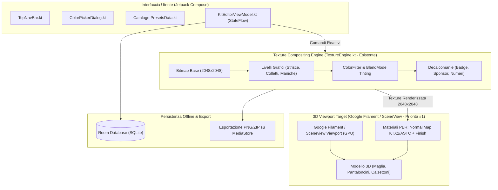

# Piano di Porting Android Nativo: fifakitcreator.com -> OpenKit Studio
**Progetto di Riferimento:** [`openkit-studio.zip`](file:///c:/Progetti/OpenKit%20Maker/openkit-studio.zip)  
**Target:** Applicazione nativa Android (APK) ottimizzata per 60/120 FPS, efficienza energetica e operatività offline.

---

### Inquadramento di Conformità ed Esclusione Marchi Terzi

> [!WARNING]
> **Avvertenza su Proprietà Intellettuale e Marchi di Terzi:**  
> Il porting Android è rigorosamente limitato all'architettura software e alle funzionalità del motore grafico. Gli asset grafici di terze parti rilevati durante l'audit (marchi di produttori come Adidas, loghi EA Sports / FIFA, stemmi di club) sono protetti da copyright e marchi registrati, rimangono soggetti alle rispettive licenze d'uso e **non costituiscono oggetto di porting o ridistribuzione**. Il committente si assume la piena ed esclusiva responsabilità legale circa la titolarità dei contenuti caricati nell'applicazione finale.

---

## 1. Priorità #1 di Sviluppo: Sblocco Funzionale del Rendering 3D

> [!CAUTION]
> **Diagnosi del Codice Esistente (`Kit3DRenderer.kt`):**  
> L'analisi del codice in [`openkit-studio.zip`](file:///c:/Progetti/OpenKit%20Maker/openkit-studio.zip) mostra che [`Kit3DRenderer.kt`](file:///c:/Progetti/OpenKit%20Maker/openkit-studio.zip) implementa una **proiezione 3D software su CPU con illuminazione Gouraud (Blinn-Phong per vertice/poligono calcolato in CPU)**:
> ```kotlin
> // Estratto da Kit3DRenderer.kt:
> val x1 = px * cosY + pz * sinY
> val z1 = -px * sinY + pz * cosY
> val y2 = py * cosP - z1 * sinP
> val z2 = py * sinP + z1 * cosP
> // Ordinamento CPU per Z:
> transformedList.sortBy { it.avgZ }
> // Disegno manuale su canvas 2D:
> drawScope.drawIntoCanvas { canvas -> canvas.drawPath(path, fillPaint) }
> ```
> Su dispositivi mobili reali, questa implementazione software priva di fragment shader comporta un **framerate degradato, tipicamente inferiore ai 20 FPS** (con singoli frame che eccedono i 50 ms su dispositivi mid-range / entry-level) durante la rotazione dell'anteprima 3D, saturando la CPU e causando battery drain.  
> **La migrazione verso Google Filament (Vulkan / OpenGL ES 3.0 con SceneView) è la Priorità #1 e prerequisito funzionale abilitante per raggiungere 60–120 FPS stabili.**

---

## 2. Mappatura Dettagliata dei Moduli Funzionali Web vs Android

| Modulo Web Rilevato (fifakitcreator) | Ruolo & Comportamento Web | Modulo Android Esistente ([`openkit-studio.zip`](file:///c:/Progetti/OpenKit%20Maker/openkit-studio.zip)) | Stato nel Repository & Roadmap di Porting |
|---|---|---|---|
| **`three.gfa8n7hq.js`** | Rendering 3D WebGL con normal map PBR e luci | [`Kit3DRenderer.kt`](file:///c:/Progetti/OpenKit%20Maker/openkit-studio.zip) | **GIA IMPLEMENTATO (Software)**: Proiezione CPU con Gouraud shading (Blinn-Phong per vertice) e preset luci (`STUDIO_NEUTRAL`, `STADIUM_NIGHT`). <br>👉 **Roadmap Priorità #1**: Migrazione a Google Filament / SceneView per delega a GPU hardware (Vulkan/OpenGL ES 3.0) e caricamento normal map KTX2/ASTC a 60–120 FPS. |
| **Pannelli Grafici & Colletti** (`jersey_side_panels_24.png`, `collar_trim_24.png`) | Layering texture 2D raster | [`TextureEngine.kt`](file:///c:/Progetti/OpenKit%20Maker/openkit-studio.zip) | **GIA IMPLEMENTATO (Completo, 500+ righe)**: Compositing multi-layer con `ColorFilter`, disegno bordi/ombre e ricoloramento istantaneo a 2048x2048. |
| **`HotspotsEditor.d4650opc.js`** & **`Printing.k882p2dk.js`** | Editor di posizionamento interattivo di sponsor, stemmi, numeri e nomi | [`KitModels.kt`](file:///c:/Progetti/OpenKit%20Maker/openkit-studio.zip) & `TopNavBar.kt` | **GIA IMPLEMENTATO**: Gestione decalcomanie e disegno testo sagomato su arco (`drawTextOnPath`) e render numeri squad. |
| **`freeformPath.fco301ts.js`** | Generazione di pattern e forme geometriche personalizzate | `TextureEngine.kt` (Vector Subsystem) | **GIA IMPLEMENTATO**: Tracciati vettoriali con Android `Path` + `Paint` per strisce diagonali (`BRAND_TRIPLE_STRIPES`, swoosh, loghi). |
| **`SavedKits.hrff6nxm.js`** & **`localStorage.kelp7spe.js`** | Persistenza kit e preferenze | [`PresetsData.kt`](file:///c:/Progetti/OpenKit%20Maker/openkit-studio.zip) | **GIA IMPLEMENTATO (Memoria)**: Preset divise e modelli. <br>👉 **Roadmap**: Integrazione Room Database (SQLite) per salvataggio offline persistente su disco. |
| **`FifaDownloadModal.di2o1s6x.js`** | Esportazione texture unificata per il gioco | `TextureEngine.kt` (Export Manager) | **GIA IMPLEMENTATO (Bitmap)**: Esportazione bitmap. <br>👉 **Roadmap**: Impacchettamento con `ZipOutputStream` su MediaStore Android. |

---

## 3. Architettura della Pipeline Grafica Nativa Target



---

## 4. Sintesi dei Guadagni Prestazionali su Android

1. **Da FPS < 20 Software a 60–120 FPS GPU**:
   - L'attuale proiezione software in `Kit3DRenderer.kt` occupa il 100% di un core CPU per calcolare matrici e disegnare poligoni 2D.
   - Con Google Filament / SceneView, i vertici e il lighting PBR vengono calcolati via shader hardware su GPU Vulkan/OpenGL ES 3.0 con overhead CPU prossimo allo zero.
2. **Abbattimento dell'Allocazione VRAM del 75% (KTX2 ASTC)**:
   - Sostituendo le normal map PNG non compresse (16,7 MB VRAM per mappa) con KTX2 ASTC 6x6 (4,1 MB VRAM), l'impronta complessiva dei layer PBR scende da oltre 64 MB a meno di 16 MB.
3. **Operatività 100% Offline**:
   - Eliminazione dei 2,17 MiB di download per sessione iniziale grazie al salvataggio locale dei cataloghi e dei template su Room DB.
