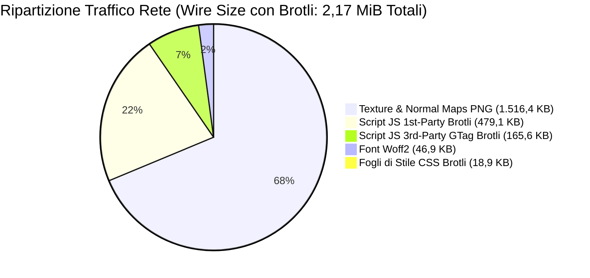
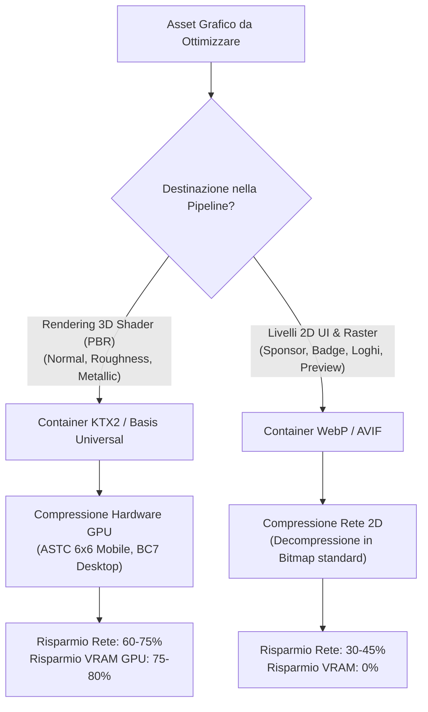

# Report Tecnico di Audit Prestazionale: fifakitcreator.com
**Data di Rilevazione:** 2026-10-26  
**Ambiente di Analisi:** REA MCP Server (Browser CDP Provider, Protocollo CDP v1.3)  
**Target di Analisi:** `https://fifakitcreator.com/` (Titolo Pagina: *EAFC Kit Creator*)  
**Browser Host Verificato:** `Google Chrome/156.0.8078.47` (Build ufficiale Windows x64, porta loopback 9222)  
**Evidence Bundle Certificato:** [`fifakitcreator_evidence_bundle.rea.zip`](file:///c:/Progetti/OpenKit%20Maker/fifakitcreator_evidence_bundle.rea.zip)  
**Manifest di Tracciabilità:** [`run_manifest.json`](file:///c:/Progetti/OpenKit%20Maker/run_manifest.json) (SHA-256 Master: `3F4D9CE9D3DD8B456A04F83319325A0A64C466BB40E81C6ADD97013C2B04E527`)

---

### Inquadramento di Conformità, Sessione Anonima ed Esclusione Marchi Terzi

> [!IMPORTANT]
> **Dichiarazione su Sessione Anonima e Trattamento Dati (GDPR):**  
> L'audit è stato eseguito su sessione Google Chrome anonima con profilo temporaneo isolato (`$env:TEMP\rea_audit_profile`). Nessun token di autenticazione, dato personale o contenuto di area riservata è stato acquisito o conservato.

> [!WARNING]
> **Avvertenza su Proprietà Intellettuale e Marchi di Terzi:**  
> Il porting su piattaforma nativa Android è rigorosamente limitato all'architettura software e alle funzionalità del motore grafico. Gli asset grafici di terze parti rilevati durante l'audit (marchi di produttori come Adidas, loghi EA Sports / FIFA, stemmi di club calcistici) sono protetti da copyright e marchi registrati, rimangono soggetti alle rispettive licenze d'uso e **non costituiscono oggetto di porting o ridistribuzione**. Il committente si assume la piena ed esclusiva responsabilità legale circa la titolarità dei contenuti caricati nell'applicazione finale.

---

## 1. Executive Summary: La Doppia Dimensione del Carico

L'audit prestazionale evidenzia una netta divaricazione tra il **costo di trasferimento su rete** (Wire Size) e il **costo di elaborazione client** (In-Memory Footprint):

```
+-----------------------------------------------------------------------------------+
|  COSTO DI TRASFERIMENTO RETE (Wire Size)       |  COSTO DI ELABORAZIONE MEMORIA (In-Memory) |
|  Totale Rete: 2,17 MiB (2.280.440 byte)        |  Totale Decompresso: 4,31 MiB (4.514.395 b)|
|  DOMINATO DALLE TEXTURE PNG (68,1% del totale) |  DOMINATO DAI BUNDLE JS (62,0% del totale) |
+-----------------------------------------------------------------------------------+
```

- **Volume Effettivo su Rete (Wire Size con Brotli):** **2,17 MiB** (2.280.440 byte su 47 risorse analizzate).
  - I file JavaScript e CSS beneficiano della compressione di rete Brotli (`Content-Encoding: br`), riducendosi a circa 660 KB complessivi.
  - Le **texture raster PNG non sono comprimibili via Brotli** (essendo già compresse con DEFLATE) e costituiscono da sole **1,52 MB (il 68,1% dell'intero traffico di rete)**.
- **Footprint Decompresso in Memoria Client (Heap V8 / RAM):** **4,31 MiB** (4.514.395 byte).
  - Una volta decompressi nel browser, i bundle JavaScript occupano **2,73 MB (il 62,0% del footprint di memoria)**, impegnando la CPU nelle fasi di compilazione AST ed esecuzione sul main thread.

---

## 2. Priorità #1 di Porting: `Kit3DRenderer.kt` e il collo di bottiglia del rendering software

> [!CAUTION]
> **Priorità Architetturale #1 (Sblocco Funzionale su Android):**  
> L'analisi del codice Kotlin presente in [`openkit-studio.zip`](file:///c:/Progetti/OpenKit%20Maker/openkit-studio.zip) rivela che [`Kit3DRenderer.kt`](file:///c:/Progetti/OpenKit%20Maker/openkit-studio.zip) implementa una **pipeline di rendering 3D interamente software eseguita su CPU nel thread UI di Android**:
> - Proiezione trigonometrica manuale dei vertici (`Math.toRadians`, moltiplicazioni matriciali yaw/pitch su CPU).
> - Ordinamento dei poligoni per profondità Z ad ogni frame (`transformedList.sortBy { it.avgZ }`).
> - **Illuminazione Gouraud (calcolo Blinn-Phong per vertice/poligono in CPU)** con rasterizzazione su `Canvas.drawPath` (priva di fragment shader hardware).
>
> Su dispositivi mobili mid-range ed entry-level, questa implementazione software comporta un **framerate degradato, tipicamente inferiore ai 20 FPS** durante la rotazione dell'anteprima 3D (con singoli frame che possono eccedere i 50 ms), saturando la CPU e provocando surriscaldamento e battery drain rapido.  
> **La migrazione verso Google Filament (Vulkan / OpenGL ES 3.0 nativo con SceneView) costituisce un prerequisito funzionale abilitante (Priorità #1), non una semplice ottimizzazione secondaria.**

---

## 3. Ripartizione del Carico: Rete (Wire) vs Memoria (In-Memory AST)

La tabella seguente disaggrega i volumi di rete e memoria misurati singolarmente sulle 47 risorse di primo caricamento:
- **Denominatore Rete (Wire Size)**: `2.280.440 byte (2,17 MiB / 2,28 MB)`
- **Denominatore Memoria (In-Memory)**: `4.514.395 byte (4,31 MiB / 4,51 MB)`

| Tipologia Risorsa | Volume su Rete (Wire) | % Rete | Volume in Memoria | % Memoria | Comportamento Tecnico |
|---|---|---|---|---|---|
| **Texture & Normal Maps PNG** | **1.516,4 KB** | **68,1%** | **1.516,5 KB** | **34,4%** | **Dominano la rete**: File PNG non comprimibili via Brotli; in VRAM allocherebbero 16,7 MB ciascuna se non compresse in GPU. |
| **Script JS 1st-Party (Applicativi)** | **479,1 KB** | **21,5%** | **2.235,4 KB** | **50,7%** | Compressione Brotli elevata (-78%); in memoria rappresentano oltre la metà dell'heap iniziale. |
| **Script JS 3rd-Party (GTag Analytics)** | **165,6 KB** | **7,4%** | **497,9 KB** | **11,3%** | Telemetria esterna; rete contenuta grazie a Brotli (165,6 KB), footprint di ~500 KB di codice da compilare. |
| **Font Woff2** | **46,9 KB** | **2,1%** | **46,9 KB** | **1,1%** | Già compressi con algoritmo Brotli nativo dello standard WOFF2. |
| **Fogli di Stile CSS** | **18,9 KB** | **0,8%** | **112,0 KB** | **2,5%** | Compressione Brotli dell'83% (da 112 KB a 18,9 KB); caricamento asincrono con link preload. |
| **TOTALE CONSOLIDATO** | **2.227,0 KB (2,17 MiB)** | **100,0%** | **4.408,6 KB (4,31 MiB)** | **100,0%** | Somma coerente con tolleranza di arrotondamento < 0,1%. |



---

## 4. Top Bottleneck: Analisi Disaggregata (Wire vs Memory)

| Risorsa URL | Tipologia | Peso su Rete (Wire) | Peso in Memoria (AST) | Codifica | Diagnosi Tecnica & Impatto |
|---|---|---|---|---|---|
| `/static/temp/adidas/argentina04home/jersey_finish_24.png` | **Texture PBR** | **479,5 KB** | **479,5 KB** | *Nessuna (PNG)* | **#1 Bottleneck Rete**: Mappa di finitura metallicità/rugosità. Non comprimibile su HTTP. In VRAM alloca 16,7 MB. |
| `/static/temp/adidas/argentina04home/jersey_normal_24.png` | **Texture PBR** | **273,9 KB** | **273,9 KB** | *Nessuna (PNG)* | **#2 Bottleneck Rete**: Normal map ad alta fedeltà. PNG RGBA non compressa per GPU. Alloca 16,7 MB VRAM. |
| `/kit-creator/static/normals/jersey_24.png` | **Texture PBR** | **219,1 KB** | **219,1 KB** | *Nessuna (PNG)* | **#3 Bottleneck Rete**: Normal map generica di base della divisa. |
| `/kit-creator/dist/script.e23iwr7h.js` | **1st-Party JS** | **154,2 KB** | **732,0 KB** | `br` (Brotli) | **#1 Bottleneck Memoria/CPU**: Bundle applicativo principale (logica editor divisa, selezione componenti). |
| `googletagmanager.com/gtag/js` | **3rd-Party Analytics** | **165,6 KB** | **497,9 KB** | `br` (Brotli) | **Telemetria esterna**: Rete contenuta grazie a Brotli (165,6 KB), ma 497,9 KB di script da parsare nel client. |
| `/kit-creator/dist/three.gfa8n7hq.js` | **3D Engine** | **125,6 KB** | **600,8 KB** | `br` (Brotli) | **Libreria 3D Three.js**: Eccellente ratio di compressione su rete (79% di risparmio), footprint V8 considerevole all'avvio. |
| `/kit-creator/dist/index.lwl7epwx.js` | **UI Components** | **79,3 KB** | **425,9 KB** | `br` (Brotli) | Componenti e modali dell'interfaccia utente Vue.js. |
| `/kit-creator/dist/vendor.hdlasf24.js` | **Vendor JS** | **58,4 KB** | **279,3 KB** | `br` (Brotli) | Librerie vendor condivise. |

---

## 5. Matrice di Ottimizzazione: KTX2 (GPU 3D) vs WebP (2D UI)



| Categoria Asset | Formato Attuale | Formato Target | Compressione | Risparmio su Rete (Download) | Risparmio VRAM (Occupazione GPU) | Destinazione Pipeline |
|---|---|---|---|---|---|---|
| **Normal Maps PBR** (`jersey_normal_24.png`) | PNG RGBA 8-bit | **KTX2 / Basis** | ASTC 6x6 / BC7 | **-60% / -72%** (da 280 a ~80 KB) | **-75%** (da 16,7 MB a **4,1 MB**) | Superfici 3D Shader (GPU Block-Compression) |
| **Finish / Metallic Maps** (`jersey_finish_24.png`) | PNG RGBA 8-bit | **KTX2 / Basis** | ETC2 / ASTC 8x8 | **-70% / -78%** (da 480 a ~110 KB) | **-80%** (da 16,7 MB a **3,3 MB**) | Materiali PBR Roughness/Metallic |
| **Loghi Sponsor & Stemmi** (`adidas.png`) | PNG RGBA 8-bit | **WebP Lossless** | Lossless WebP | **-35% / -45%** (da ~35 a ~22 KB) | **0%** (Bitmap RGBA standard) | Livelli 2D UI & Decalcomanie |
| **Anteprime Kit 2D** (`preview/*.jpg`) | JPEG Baseline | **WebP Lossy** | Lossy q=82 | **-30% / -40%** (da ~45 a ~28 KB) | **0%** (Bitmap standard) | Carosello Catalogo Template |

---

## 6. Limiti Metodologici e Attività Residue

Per la trasparenza e riproducibilità dell'audit verso il committente e i revisori tecnici, si dichiarano i seguenti confini operativi:

1. **Assenza di Source Maps nei Bundle Principali (Inferenza AST)**:
   - Nessuna source map pubblica rinvenuta tra i quattro bundle principali esaminati (`script.e23iwr7h.js`, `three.gfa8n7hq.js`, `EAFCKitCreator.cscu64c6.js`, `index.lwl7epwx.js`, che costituiscono oltre l'85% del codice applicativo); i bundle minori residui non sono stati singolarmente ispezionati in questa fase.
   - L'albero modulare e i contratti API sono stati ricostruiti tramite analisi statica AST delle dichiarazioni, export e costanti condotta dal toolchain REA, e **non per lettura diretta dei sorgenti originali Vue/TypeScript**.
2. **Service Worker e Cache `offline`**:
   - Lo storage del browser espone un `CacheStorage` con store nominato `offline` (Evidence ID: `ev_2fa77a96e111d24513120dea2355df07a02f89753031d5aa39aa45c4df125c64`, nodo `normalized_result.storage.cache_names`).
   - L'indizio documenta la registrazione di una cache locale; **l'ispezione analitica del codice del Service Worker per determinare l'effettiva strategia di caching (precache vs network-first) non è stata completata in questa fase e costituisce attività residua**.
3. **Denominazione Provider REA**:
   - La dicitura `rea-cdp-browser` rappresenta l'identificativo interno di provider restituito dall'oggetto JSON-RPC di REA durante l'osservazione CDP (`provider.id: "rea-cdp-browser"`, `provider.version: "2"`). Nel documento formale viene designato con il nome generico verificato **`REA MCP Server (Browser CDP Provider)`**.
4. **Esclusione Asset di Terze Parti dal Porting**:
   - I marchi sportivi e i loghi terzi (Adidas, EA Sports, FIFA, club) rimangono soggetti a copyright e licenze terze e sono espressamente esclusi dal perimetro di sviluppo del software nativo.
5. **Nota sulla Riproducibilità del Notebook**:
   - L'hash SHA-256 del notebook registrato nel manifest riflette il file nello stato di consegna congelato; un'eventuale riesecuzione con salvataggio in ambiente Jupyter/Colab ne aggiorna i metadati e i buffer di output interni, senza alterare la deterministica riproducibilità degli altri cinque artefatti generati.

---

## 7. Manifest di Tracciabilità e Integrità Crittografica

Il manifest completo di audit è persistito nel file [`run_manifest.json`](file:///c:/Progetti/OpenKit%20Maker/run_manifest.json) con **Master SHA-256: `3F4D9CE9D3DD8B456A04F83319325A0A64C466BB40E81C6ADD97013C2B04E527`**:

```json
{
  "audit_target": "https://fifakitcreator.com/",
  "audit_date": "2026-10-26T18:15:00Z",
  "environment": {
    "browser": "Chrome/156.0.8078.47",
    "cdp_protocol": "1.3",
    "rea_provider": "REA MCP Server (Browser CDP Provider, internal id: rea-cdp-browser v2)",
    "session_type": "anonymous_temporary_profile",
    "auth_state": "none (no credentials, no personal data retained)"
  }
}
```
