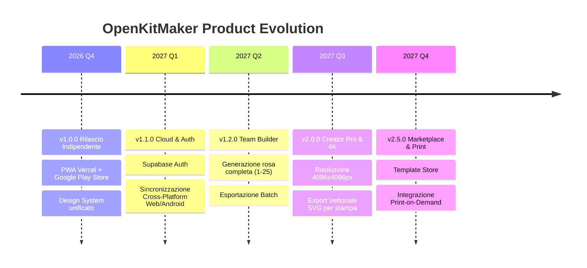

# OpenKitMaker — Roadmap di Sviluppo & Strategia Commerciale

> **Visione:** Diventare lo standard open-core di riferimento per la progettazione grafica, anteprima 3D PBR e produzione fisica di divise sportive.  
> **Autore & Fondatore:** [Marco Razzano](https://github.com/marcorzzn) (`@marcorzzn`)

---

## 🎯 Obiettivo Strategico

Trasformare **OpenKitMaker** da prototipo tecnologico certificato a **piattaforma commerciale scalabile** con modello di business **Freemium / Open-Core**, rivolta a:
1. **Comunità di Gaming & Modding**: Modder e videogiocatori che necessitano di texture compatibili con simulatori calcistici.
2. **Designer e Creator Indipendenti**: Grafici freelance che realizzano concept kit per social e portfolio.
3. **Società Sportive Dilettantistiche & Esports Team**: Squadre che necessitano di realizzare divise personalizzate senza intermediari costosi.
4. **Produttori e Service di Stampa a Sublimazione**: Brand tecnici che cercano uno strumento web integrabile per i propri clienti.

---

## 🗺️ Fasi di Sviluppo

---

### Fase 1: Consolidamento e Lancio Pubblico (v1.0.0) — *IN CORSO*
- [x] Sviluppo Svelte 5 con Runes, Three.js lazy loading e Dexie IndexedDB.
- [x] Sviluppo Android Nativo con Jetpack Compose Material 3 e Google Filament PBR GPU.
- [x] Standard di esportazione interoperabile `kit_<id>.zip` con firma SHA-256.
- [x] Pubblicazione repository open-source con licenza MIT.
- [x] Fase 1: Core Bug Fixing (Riparazione 3D WebGL/Filament, UV mapping maniche 2D/3D, Riprogettazione UI Material 3 con Scaffold & NavigationBar).
- [ ] Messa online della PWA su dominio personalizzato (es. `openkitmaker.dev` o `openkitmaker.com` via Vercel).
- [ ] Pubblicazione su Google Play Store (`com.marcorzzano.openkitmaker`).
- [ ] Campagna di lancio su Reddit (r/footballkits, r/ConceptFootball), Twitter/X e community Discord.

---

### Fase 2: Backend Cloud, Account e Sincronizzazione (v1.1.0 – v1.2.0)
- **Autenticazione Leggera**:
  - Integrazione di **Supabase** (PostgreSQL + Auth) o **PocketBase** self-hosted.
  - Login sociale a 1-click (Google, GitHub, Apple).
- **Cloud Sync Bidirezionale**:
  - Salva su smartphone Android -> continua la modifica su PC desktop via browser istantaneamente.
  - Risoluzione automatica dei conflitti basata su timestamp ISO-8601 UTC.
- **Vetrina Creator & Link Pubblici**:
  - Generazione di URL pubblico condivisibile (`openkitmaker.dev/@marcorzzn/milano-home-2026`).
  - Anteprima dinamica Open Graph per Twitter, Discord e WhatsApp con render 3D fotorealistico generato via serverless edge.

---

### Fase 3: Funzionalità Avanzate "Team Builder" & Batch (v1.3.0)
- **Generatore di Squadra (Full Squad Roster)**:
  - Inserisci la lista della rosa (nome, numero, taglia) e genera automaticamente tutti i 25 kit da gara.
  - Riconoscimento automatico del kit portiere con palette complementare invertita.
- **Esportazione Batch**:
  - Generazione archivio ZIP unico contenente tutti i file della squadra pronti per la stampa o l'importazione in gioco.
- **Supporto Pantaloncini e Calzettoni**:
  - Estensione del compositing 2D e della mesh 3D all'intero completo da gara.

---

### Fase 4: Monetizzazione & Modello "OpenKitMaker Pro" (v2.0.0)

| Funzionalità | Versione Gratuita (Community) | OpenKitMaker PRO (4.99€/mese o 39€/anno) |
| :--- | :--- | :--- |
| **Risoluzione Texture** | 2048×2048 px (Full HD) | **4096×4096 px (4K Ultra-HD)** |
| **Formati di Esportazione** | PNG + ZIP standard | **Vettoriale SVG / PDF per plotter da stampa** |
| **Persistenza** | Illimitata in locale (IndexedDB / Room) | **Cloud Backup Illimitato con cronologia versioni** |
| **Team Builder** | Singolo kit alla volta | **Generazione Batch intera rosa (fino a 30 maglie)** |
| **Catalogo Template** | 10 template geometrici base | **Oltre 100 template avanzati + aggiornamenti mensili** |
| **Preset Illuminazione** | Studio & Stadio | **Ambienti HDR personalizzati, studio cinematografico** |
| **Watermark** | Nessuno | **Nessuno + Firma personalizzata del designer** |

---

### Fase 5: Ecosistema Marketplace & Print-on-Demand (v2.5.0)
- **Marketplace Creator**:
  - I grafici possono pubblicare template e pattern geometrici esclusivi guadagnando una percentuale sulle vendite (70% al creator / 30% a OpenKitMaker).
- **Integrazione "Dallo Schermo al Campo" (Print-on-Demand)**:
  - Partnership con laboratori di stampa a sublimazione tessile.
  - Pulsante *"Ordina questa maglia reale"*: ricevi la divisa cucita e stampata a casa con tessuti tecnici traspiranti professionali.

---

## 💼 Canali di Contatto per Partnership & Investimenti

**Marco Razzano**  
- GitHub: [marcorzzn](https://github.com/marcorzzn)  
- Repository: [github.com/marcorzzn/OpenKitMaker](https://github.com/marcorzzn/OpenKitMaker)
